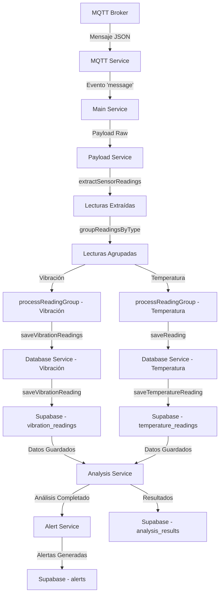
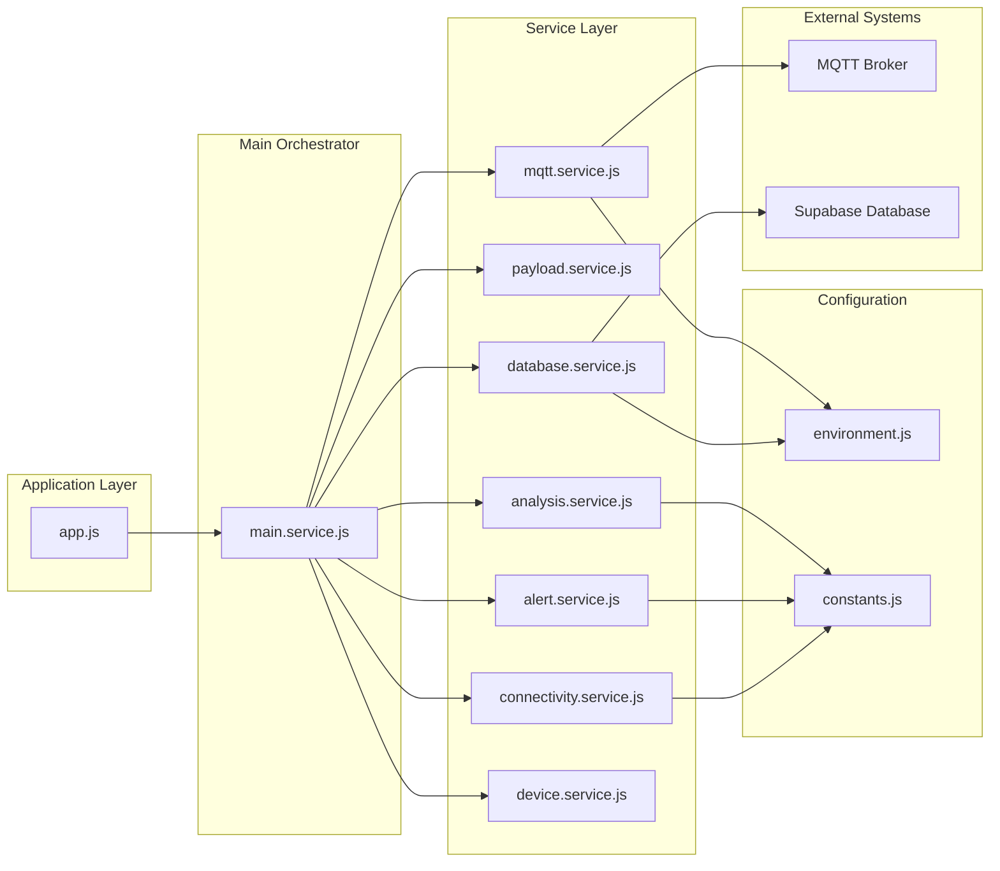
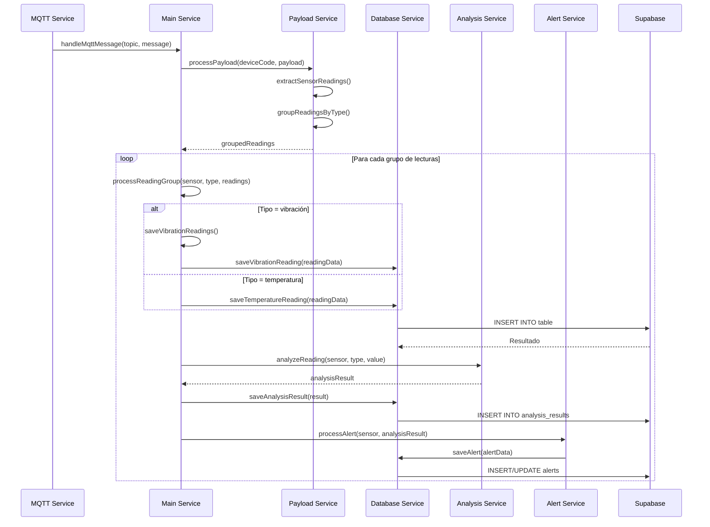
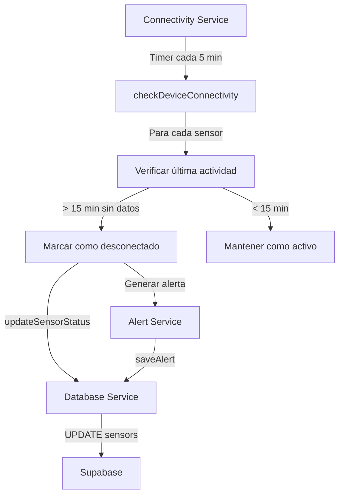
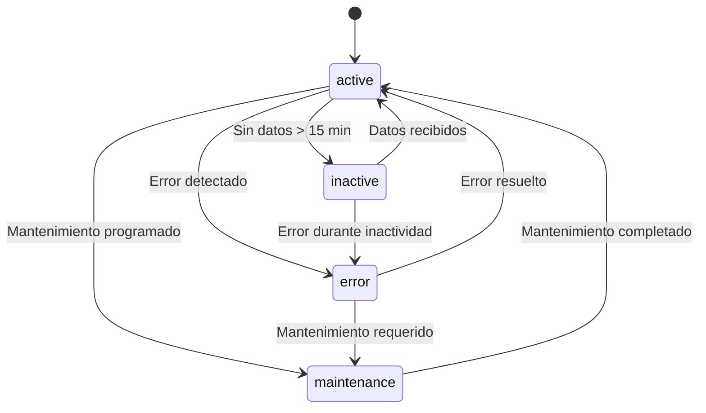
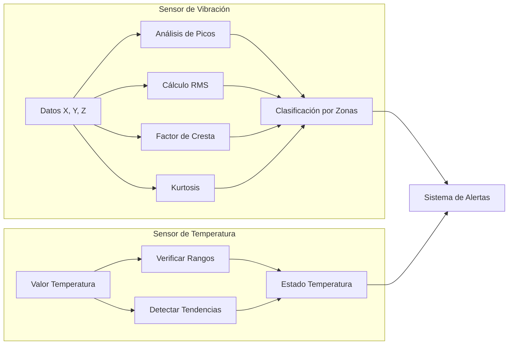
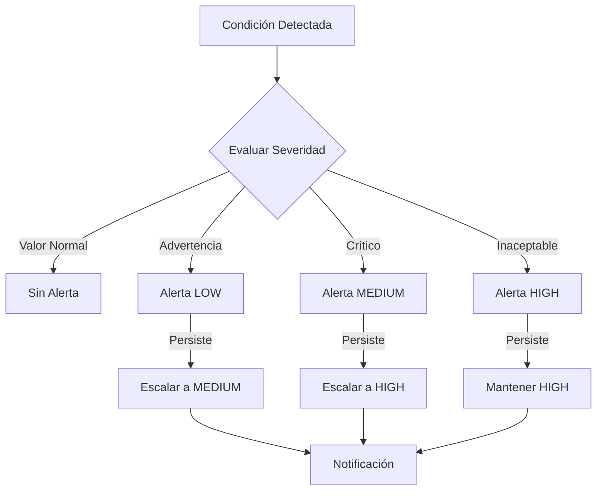
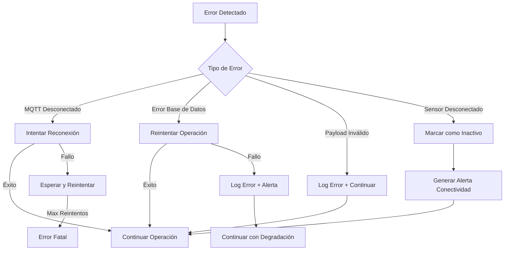

# Diagrama de Flujo de Servicios - Vibrai Backend

## Flujo Principal de Datos



## Arquitectura de Servicios



## Flujo de Procesamiento de Lecturas



## Flujo de Conectividad



## Estados de Sensores



## Tipos de Análisis por Sensor



## Prioridades de Alertas



## Manejo de Errores y Recuperación



## Configuración y Dependencias

```mermaid
graph LR
    subgraph "Variables de Entorno"
        ENV1[SUPABASE_URL]
        ENV2[SUPABASE_SERVICE_ROLE_KEY]
        ENV3[MQTT_BROKER_URL]
        ENV4[NODE_ENV]
        ENV5[TZ]
    end
    
    subgraph "Constantes del Sistema"
        CONST1[SPIKE_THRESHOLD_MULTIPLIER]
        CONST2[CONNECTIVITY_TIMEOUT_MINUTES]
        CONST3[LOW_BATTERY_THRESHOLD_VOLT]
        CONST4[ALERT_TYPES]
        CONST5[SENSOR_STATUS]
    end
    
    subgraph "Dependencias NPM"
        DEP1[@supabase/supabase-js]
        DEP2[mqtt]
        DEP3[dotenv]
        DEP4[lodash]
    end
    
    ENV1 --> DB[Database Service]
    ENV2 --> DB
    ENV3 --> MQTT[MQTT Service]
    
    CONST1 --> ANALYSIS[Analysis Service]
    CONST2 --> CONN[Connectivity Service]
    CONST3 --> DEVICE[Device Service]
    CONST4 --> ALERT[Alert Service]
    CONST5 --> MAIN[Main Service]
    
    DEP1 --> DB
    DEP2 --> MQTT
    DEP3 --> ENV[Environment Config]
    DEP4 --> PAYLOAD[Payload Service]
```

---

## Notas Importantes

### Flujo de Datos Críticos
1. **Orden de Procesamiento**: Los datos siempre siguen el flujo MQTT → Payload → Database → Analysis → Alerts
2. **Transaccionalidad**: Cada lectura se procesa de forma independiente para evitar pérdida de datos
3. **Recuperación**: Los errores en un sensor no afectan el procesamiento de otros sensores

### Optimizaciones Implementadas
1. **Métodos Específicos**: `saveVibrationReading()` y `saveTemperatureReading()` evitan problemas de esquema
2. **Agrupamiento Inteligente**: Las lecturas se agrupan por tipo para procesamiento eficiente
3. **Logging Estructurado**: Facilita el debugging y monitoreo del sistema

### Escalabilidad
1. **Servicios Independientes**: Cada servicio puede escalarse por separado
2. **Procesamiento Asíncrono**: No bloquea el flujo principal de datos
3. **Base de Datos Optimizada**: Tablas especializadas para cada tipo de lectura